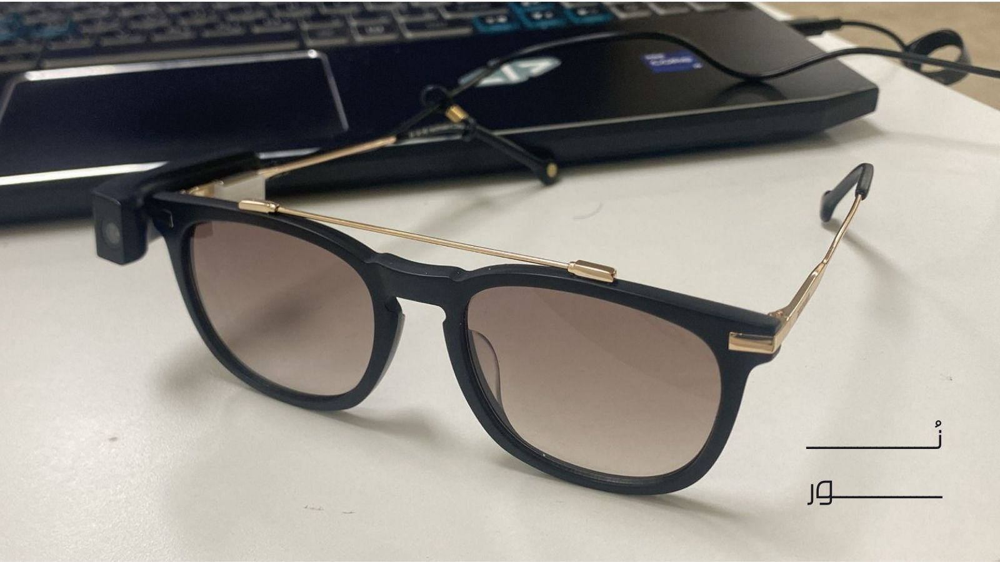
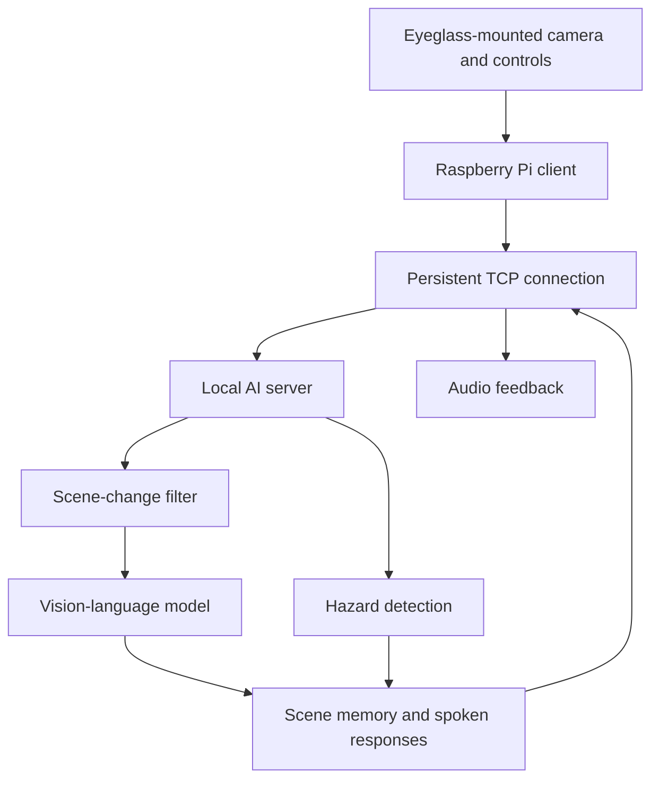
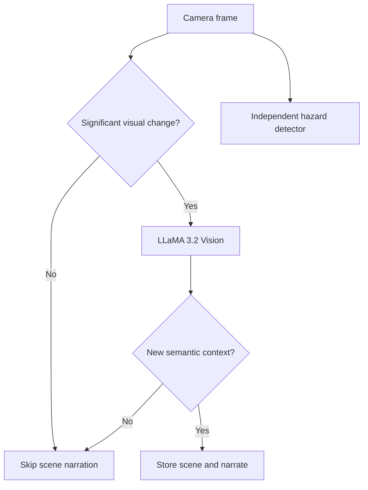
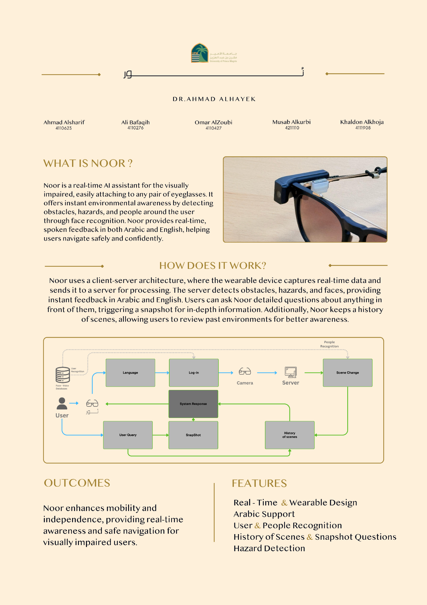

# NOOR | Smart glasses for blind and visually impaired people 

<p align="center">
  
</p>

<p align="center"><strong>See the scene. Hear the context.</strong></p>

NOOR is a bilingual assistive-AI prototype for people who are blind or visually impaired. It combines scene narration, hazard detection, visual question answering, recognition of familiar people, and short-term scene memory in a spoken interface. The wearable was conceived as a **detachable module that mounts on the user's preferred eyeglass frame**, including a frame chosen for comfort, style, or prescription.

> **Research proof of concept.** The pictured enclosure and the Raspberry Pi–server setup demonstrate the system; they are neither a final product design nor minimum hardware requirements. NOOR complements established mobility aids and has not been validated as a replacement for them.

## At a glance

| Capability | Prototype approach |
| --- | --- |
| Scene narration | LLaMA 3.2 Vision describes meaningful visual changes |
| Hazard alerts | Custom YOLOv8-nano detector for crosswalks, potholes, and stairs at runtime |
| Visual Q&A | Spoken questions are answered using a captured camera frame |
| Scene history | Up to 10 recent scenes retrieved by semantic similarity and recency |
| People recognition | Announces previously registered people in view |
| User authentication | Face recognition or SpeechBrain ECAPA voice embeddings |
| Interaction | Arabic and English speech through local model pipelines |

## Why we built it

An assistive camera can do more than name objects in isolation. A user might need a short description of a new place, an immediate warning about a staircase, an answer about a sign, or a reminder of something seen moments earlier. NOOR brings these tasks into one wearable interaction flow while keeping compute-heavy inference away from the glasses.

## System architecture

The proof-of-concept wearable uses a Raspberry Pi 4 for camera capture, microphone input, physical controls, audio playback, and network communication. A local workstation runs the models. A persistent TCP connection carries framed camera, audio, command, and response messages between client and server.



The experimental server had an Intel Core i9, two NVIDIA RTX 4090 GPUs, and 128 GB RAM so the team could run and test several models locally. This configuration describes **our experiment**, not a proposed production bill of materials.

### Keeping scene narration useful

The active scene-change path compares color histograms between frames, then requests a short VLM description when the change passes its threshold and the description interval has elapsed. A semantic comparison helps avoid adding a near-duplicate description to scene history. Hazard detection runs separately, so an alert does not have to wait for a new scene narration.



The code also contains an optical-flow utility, but it is **not enabled** in the active scene-change decision path.

### Contextual scene memory

Meaningful scenes are stored in a fixed-size deque of at most **10** entries. `all-MiniLM-L6-v2` embeds scene context and a user's retrospective question. Retrieval ranks scenes with cosine similarity and a time-decay term:

```python
score = 0.7 * semantic_similarity + 0.3 * temporal_relevance
```

This makes questions such as “What did I pass a few minutes ago?” possible within the short retained history. The weights describe this prototype's implementation, not a general benchmark.

### Arabic and English voice paths

Vosk converts speech to text. English questions go to the vision-language workflow directly; Arabic questions are translated to English with local Mistral, and responses are translated back to Arabic with Command-R-7B Arabic before local speech output. The demonstrated core AI workflow runs locally rather than calling a hosted AI API.

## Hazard model and measured results

The team assembled a four-class dataset (`crosswalk`, `pothole`, `stairs`, `stain`) and trained **YOLOv8-nano** for 100 epochs with batch size 16 and 640 × 640 images. The dataset comprised **3,680 training**, **789 validation**, and **789 test** images. Preprocessing and augmentation included resizing, mosaic, flips, scaling, translation, and color changes. The runtime alert selection excludes `stain`.

| Measure | Reported result |
| --- | ---: |
| Training precision | ≈ 0.88 |
| Training recall | ≈ 0.85 |
| Training mAP@0.5 | ≈ 0.88 |
| Training mAP@0.5–0.95 | ≈ 0.60 |
| Separate test-set mAP@0.5 | ≈ 0.87 |

The project report records a reduction in **spoken scene-description latency from roughly 150 seconds in the early prototype to 2–3 seconds in the client–server version**. This is a reported prototype observation, not a controlled latency distribution or a guarantee in all conditions. Low light, occlusion, and missed or mistaken detections remain areas for improvement.

## Project evolution

| Iteration | What changed | Demonstration |
| --- | --- | --- |
| Version 1 | Established the core visual-assistance concept and an early working prototype. | [LinkedIn post](https://www.linkedin.com/posts/-omar-alzoubi-_%D9%83%D9%8A%D9%81-%D9%8A%D9%85%D9%83%D9%86-%D9%84%D9%84%D8%B0%D9%83%D8%A7%D8%A1-%D8%A7%D9%84%D8%A7%D8%B5%D8%B7%D9%86%D8%A7%D8%B9%D9%8A-%D8%A3%D9%86-%D9%8A%D8%B9%D9%8A%D8%AF-%D8%A7%D9%84%D9%86%D9%88%D8%B1-activity-7283153270838099970-1nDr) |
| Version 2 | Moved inference to a local server and expanded bilingual speech, hazard detection, scene history, visual Q&A, and biometric features. | [LinkedIn post](https://www.linkedin.com/posts/-omar-alzoubi-_%D9%86%D9%88%D8%B1-%D9%82%D8%A8%D9%84-%D8%AB%D9%84%D8%A7%D8%AB%D8%A9-%D8%A3%D8%B4%D9%87%D8%B1-%D8%B4%D8%A7%D8%B1%D9%83%D8%AA%D9%83%D9%85-%D8%A8%D8%AF%D8%A7%D9%8A%D8%AA%D9%86%D8%A7-%D9%85%D8%B9-activity-7317164132523282433-SC0Q) |

## My contribution and team

**Omar Alzoubi** originated the NOOR concept, led the project, designed the client–server architecture and computer-vision pipeline, and worked on integrating scene understanding and hazard detection into the full system. NOOR was a collaborative university capstone with **Ahmad Alsharif, Khaldoun Alkhoja, Ali Bafaqih, and Musab Alkorbi**, supervised by **Dr. Ahmed Elhayek**.

## Project poster

<p align="center">
  
</p>

## Repository scope

This repository is a technical case study. The full application, model weights, datasets, private configuration, and deployment instructions are **not published** here. The small scoring expression above illustrates one implementation detail without exposing the application source. The poster and prototype photograph are included in `assets/`.

NOOR remains a **research proof of concept**. Further work would involve wearable miniaturization, lower compute requirements, broader real-world evaluation with users, and stronger reliability checks for safety-related alerts.
